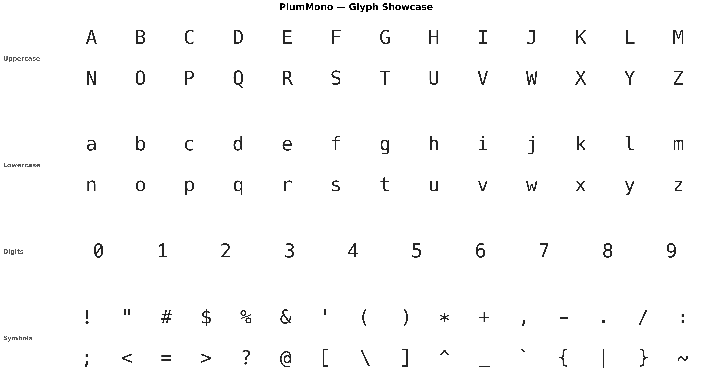

# Plum Mono

一款面向代码的等宽字体，基于 [Hack](https://github.com/source-foundry/Hack)。



[English](README.md)

---

## 简介

Plum Mono 派生自 [Hack](https://github.com/source-foundry/Hack) 字体，Hack 又构建于
[DejaVu Sans Mono](https://dejavu-fonts.github.io/) 和
[Bitstream Vera Sans Mono](https://www.gnome.org/fonts/) 之上。

本项目重设计了 Hack 的部分标点与符号字形，使其视觉气质有所不同——以 DejaVu Sans Mono
的设计为基础，并做了自定义调整。

---

## 修改内容

### 替换的字形

取自 DejaVu Sans Mono 并**加粗**（在 Regular 与 Bold 之间插值）：

| 字形 | Unicode |
|---|---|
| `:` | U+003A |
| `;` | U+003B |
| `,` | U+002C |
| `.` | U+002E |
| `"` | U+0022 |
| `'` | U+0027 |
| `*` | U+002A |

### 其他调整

- **星号** `*` —— 垂直居中，与 `+` 对齐
- **下划线** `_` —— 拉满字宽，相邻下划线相连（`__` 无断口）
- **数字 `1`** —— 顶部衬线角度取 Hack 与 DejaVu 的折中
- **数字 `0`** —— 斜杠零，四个字重的斜杠粗细一致
- **组合标记** —— 向 Regular 移植 67 个标记（U+0300–036F），使其覆盖的码位与
  Bold/Italic/BoldItalic 一致，并加入 `mark`/`mkmk` GPOS 定位。
  详见 [COMBINING_MARKS.md](COMBINING_MARKS.md)

### 零的两种形态

默认 `0` 为斜杠零。**点零**以 alt glyph 形式提供，构建为独立家族，两者可同时安装：

| 家族 | `0` | 构建方式 |
|---|---|---|
| Plum Mono | 斜杠 | 默认构建 |
| Plum Mono `Dotted` | 点 | `python build.py all --alt dotted --suffix Dotted` |

---

## 构建

以下是构建示例，详细构建命令见 `python build.py --help`

```bash
conda activate develop
python build.py --install-deps                        # pip 安装 fontmake, fonttools, zopfli, brotli
python build.py ttf                                   # 基础家族   -> build/ttf/PlumMono/
python build.py all --alt dotted --suffix Dotted      # 点零家族   -> build/ttf/PlumMono-Dotted/
```

依赖 Python 3 及 `fontmake`、`fonttools`、`zopfli`、`brotli`。

`build_bolder.py` 与之相同，只多一步：fontmake 编译完成后，对 Regular 和 Italic 的轮廓
做轻度加粗（FontForge `changeWeight`，`--amount`，默认 `25`，用 `--no-embolden` 关闭）。
这是**直接替换**这两个较轻字重，家族仍是 Regular/Bold/Italic/BoldItalic 四款。
它额外需要 FontForge 的 `ffpython`。

### 输出结构

`PlumMono[-后缀]` 即家族名去掉空格。

```
gen/PlumMono[-后缀]/          生成的变体源文件（勿手改，已 gitignore）
build/ttf/PlumMono[-后缀]/    ttf 文件（无 hinting）
build/web/PlumMono[-后缀]/    woff + woff2
source/                       唯一的、手工维护的 UFO 源
```

构建过程从不写入 `source/`；`gen/` 是一次性的，每次构建重新生成。
web 字体由构建出的 TTF 转换而来，因此请先构建 `ttf`。

### Alt glyphs（替代字形）

```
source/alt-glyphs/<字形>-<标签>/<字重>/<字形>.glif
```

即该字重下 `<字形>` 的替换件：第一个 `-` 之前是要替换的字形，之后是变体标签。
构建时会把选中的文件夹覆盖到 master UFO 的副本上，并重命名家族。

```bash
python build.py all --alt none                        # 仅基础家族        "Plum Mono"
python build.py all --alt dotted                      # 一个变体          "Plum Mono Custom"
python build.py all --alt dotted --suffix Dotted      # 指定后缀          "Plum Mono Dotted"
python build.py all --alt dotted,foo --suffix One,Two # 多变体，后缀按顺序对应
```

- `--alt` —— 一个标签、逗号分隔的多个标签、`all`（基础 + 全部变体，默认）或 `none`
- `--suffix` —— 家族名后缀，按顺序对应所选变体，默认 `Custom`
- 未修改的 master 始终保留 `Plum Mono`

---

## 许可

Plum Mono 采用 MIT License 授权。

Plum Mono 派生自 Hack，Hack 采用 MIT License，并包含 DejaVu 项目与 Bitstream Vera Sans Mono 的工作成果。

完整的许可证文本、版权声明与归属信息请见 [LICENSE](LICENSE)。
